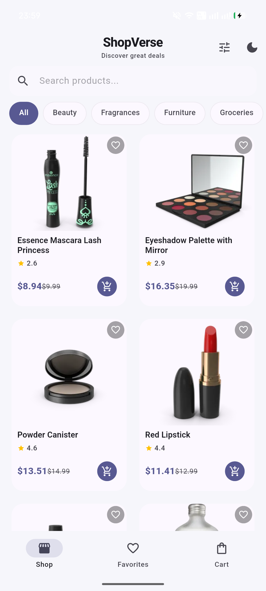
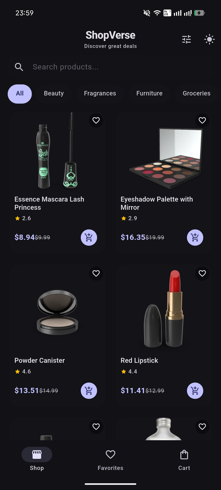
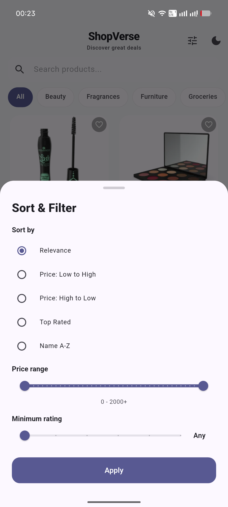
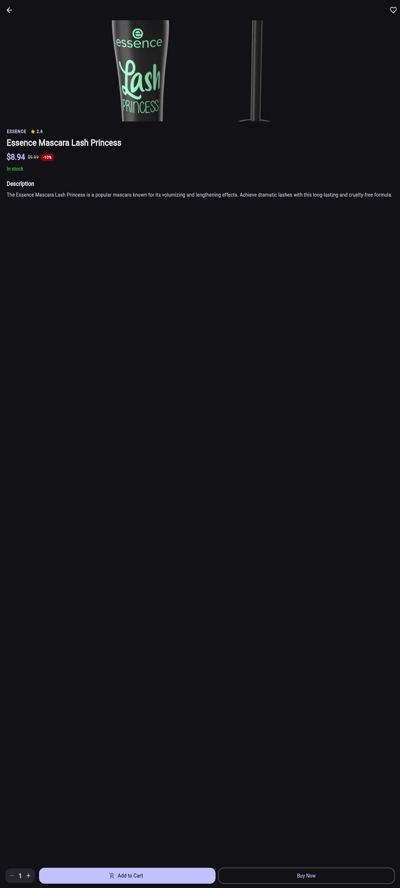
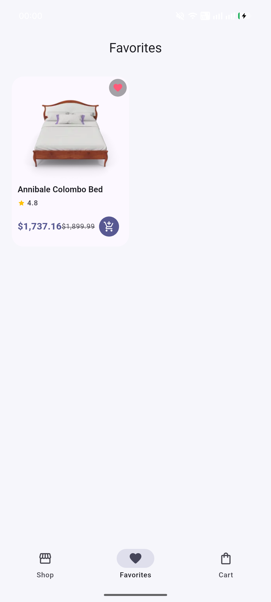
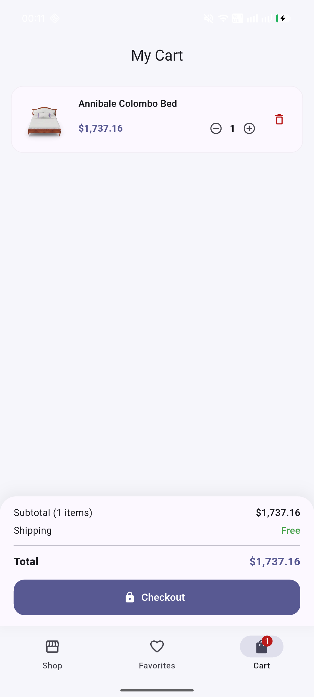
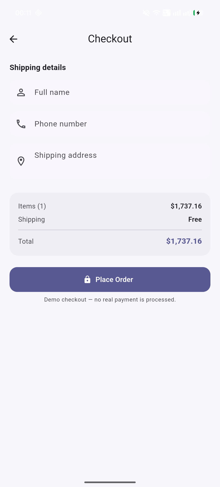

# ShopVerse

A portfolio-grade mobile and web e-commerce app built with **Flutter**, **Riverpod**, and **Hive**. It browses real products from the [DummyJSON](https://dummyjson.com) API, supports search, category filtering and sorting, a persistent shopping cart with a simulated checkout, and a favorites wishlist with light/dark theming.


[](https://github.com/Suboon-stack/flutter-shop-app/actions)

## Features

- Product browsing powered by the DummyJSON API with infinite scrolling (20 items per page)
- Instant search with debouncing
- Category chips and a sort & filter sheet (price, rating, relevance, name)
- Product detail pages with a quantity stepper
- Persistent shopping cart (Hive) with quantity controls, free shipping above $50, and a simulated checkout
- Favorites wishlist, persisted locally
- Light and dark themes with a persisted preference (system / light / dark)
- Beautiful skeleton loading states, proper empty/error handling, and pull-to-refresh

## Tech Stack

| Concern      | Choice                                    |
| ------------ | ----------------------------------------- |
| Framework    | Flutter (Android, iOS, Web)               |
| Language     | Dart 3                                    |
| State        | Riverpod (Notifiers + Providers)          |
| Persistence  | Hive (boxed JSON snapshots, no codegen)   |
| Networking   | `http` with an injectable client          |
| Architecture | Feature-first, provider-driven            |

## Screenshots

| Home — light | Home — dark |
| --- | --- |
|  |  |

| Filter & sort | Product detail |
| --- | --- |
|  |  |

| Favourites | Cart |
| --- | --- |
|  |  |

| Checkout | |
| --- | --- |
|  | |

## Getting Started

### Prerequisites

- Flutter SDK (stable channel)
- Android/iOS toolchain, or just run it on the web

### Run

```bash
flutter pub get
flutter run
```

Open `http://localhost:8080` for the web version, or pick a connected device. The app works offline-first: product data is fetched from DummyJSON, while your cart and favorites are stored locally.

### Tests

The project ships with unit tests, provider/state tests, and widget tests.

```bash
flutter analyze
flutter test
```

## Project Structure

```
lib/
  core/
    api/          # HTTP client & API exceptions
    storage/      # Hive init & box definitions
    theme/        # App theme + theme mode controller
    navigation/   # Shell tab state
    utils/        # Debouncer, price formatter
  features/
    products/     # Data models, repository, browse state, UI
    cart/         # Cart store, totals, cart & checkout screens
    favorites/    # Wishlist store and screen
  shared/
    widgets/      # Reusable shimmer, error, empty-state, price widgets
  main.dart       # Bootstrap: init storage, ProviderScope, ShopApp
```

## Notes

- Product data, prices, and images come from the DummyJSON demo API.
- Checkout is a **simulation** — no real payment is processed.